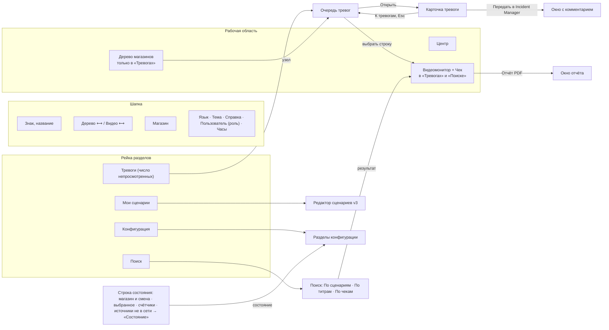
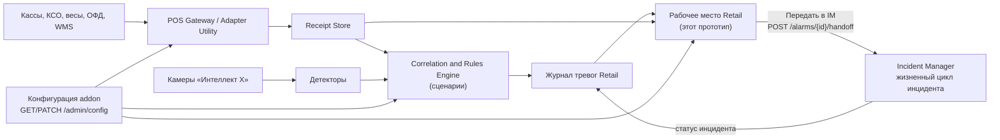

# Переработка прототипа по образцу Incident Manager — 11.11.2026

Что сделано в прототипе `prototype/index.html` (версия v5): взят интерфейс и часть архитектуры соседнего проекта Incident Manager (`../IM`), учтены замечания менеджера от 08.11 (разбор — [Рекомендации от 09.11](2026-11-09%20Рекомендации%20по%20адаптации%20прототипа.md)), добавлен выбор языка, применена обновлённая дизайн-система ONE PSIM, а всё, что настраивается на сервере, собрано в одной закладке «Конфигурация».

ТЗ v3 этой правкой не меняется. Требования менеджера по-прежнему не внесены в ТЗ — список того, что нужно перенести, в конце документа.

## 1. Что взято из Incident Manager

| Из IM | Где в IM | Как в Retail |
|---|---|---|
| Каркас рабочего места: шапка, три области (дерево · центр · видео), нижняя строка состояния | `IM/prototype/index.html`, карта экранов `Specification/Interface/SITEMAP.md` §2–§3 | то же; слева добавлена узкая рейка разделов (закладки менеджера) |
| Дерево групп с числом открытых инцидентов | панель «Группы» | дерево «Магазины»: магазин → зоны (линейные кассы, КСО, весы, торговый зал, прочие) → устройства; число непросмотренных тревог, точка связи у устройства |
| Очередь карточками: полоса приоритета, бейджи, кнопки всегда видны | очередь, правила §7 | очередь тревог: полоса приоритета, «Не просмотрена / Просмотрена», источник, статус в IM; кнопки «Отчёт PDF» и «Открыть» |
| Режимы «очередь» и «карточка» (work mode) | `data-mode="queue/work"` | «Открыть» показывает карточку тревоги с вкладками «Почему сработало», «Описание сценария», «Журнал» и нижним рядом действий; «К тревогам» и Esc — назад |
| Видеомонитор «Архив / Online», развернуть, панели прячутся кнопками в шапке | панель «Видео и карта» | «Видеомонитор» с титрами, ракурсами камер и плеером ±30 с; вместо карты — панель «Чек» (чек, причина, описание сценария) |
| Разделители панелей, ширина запоминается | `splitGroups`, `splitMedia` | `splitTree`, `splitMedia`; двойной щелчок — ширина по умолчанию |
| Язык и тема в шапке, меню справки, меню пользователя | `langSelect`, `themeToggle`, `helpMenu`, `userMenu` | то же; в меню пользователя — роль прототипа «Оператор / Администратор» |
| Одно окно на все формы | `modalDialog` | `dlg`: передача в IM, справка |
| «Настройки администратора» — все настройки одним списком со значениями | `modalAdmin`, `Workflow_machine/SETTINGS.md` | закладка «Конфигурация» (раздел 4) |
| Клиент без своей модели: экраны спрашивают сервер | `FRONTEND.md` «у клиента нет своей модели», `server.js`, `api.js` | `data.js` — демо-сервер с `RetailApi`, `config-data.js` — серверная конфигурация; экраны (`app.js`, `config.js`) справочников не держат |
| Телефон: страница не шире 360 px, разделы снизу | `mobileNav` | рейка разделов уходит вниз, дерево — шторкой, видео — под списком |
| Оформление через `bridge.css` поверх словаря `--one-*` | `IM/prototype/bridge.css` | `bridge.css` + `prototype/retail.css` (раздел 5) |

Не переносилось: машина состояний инцидента, сценарии обработки по шагам, выборка и массовые действия, перерыв и выход оператора. Это жизненный цикл инцидента — его ведёт IM (ТЗ §5.1, компонент 9), Retail только передаёт тревогу (раздел 3).

## 2. Карта экрана

| Раздел | Дерево | Видео и чек | Центр |
|---|---|---|---|
| Тревоги | да | да | очередь или карточка тревоги |
| Поиск | нет | да | режимы поиска, шаблоны, результаты |
| Мои сценарии | нет | нет | редактор сценариев (без изменений с 09.11) |
| Конфигурация | нет | нет | разделы настроек сервера |

Кнопки в шапке прячут дерево и видео; ширины и выбор панелей помнит браузер (`retail-layout`), тему и язык — `retail-theme`, `retail-lang`.

## 3. Архитектура: кто чем владеет

Правило из IM: **у экранов нет своей модели**. Список магазинов и устройств, тревоги, чеки, шаблоны поиска и настройки приходят с сервера; экран их показывает и шлёт действия. В прототипе сервер изображает `data.js`.

Черновик запросов (для ревью архитектором, не контракт):

| Запрос | Что возвращает / делает |
|---|---|
| `GET /reference/stores` | магазины, часовой пояс, смена |
| `GET /reference/tree?store=` | дерево: магазин → зоны → устройства и камеры, состояние связи |
| `GET /reference/cameras?source=` | основная камера и дополнительные ракурсы источника (ТЗ §7.2) |
| `GET /alarms?store=&node=&prio=&q=&unviewed=&from=&to=&scenario=` | очередь смены и журнал для поиска по сценариям |
| `GET /alarms/{id}` | тревога: сработавшие условия по шагам, причина, чек, просмотр, статус в IM, журнал |
| `POST /alarms/{id}/viewed` | «Просмотрена» — общий статус для всех операторов (решение 09.11) |
| `POST /alarms/{id}/handoff` | передать в Incident Manager с комментарием; дальше статус приходит от IM |
| `GET /receipts?…` | чеки для поиска по титрам и по чекам |
| `GET/POST /search/templates` | шаблоны поиска, свои и общие |
| `GET /admin/config`, `PATCH /admin/config/{section}` | закладка «Конфигурация»; правка — только администратор, с аудитом |

## 4. Закладка «Конфигурация»

Всё, что задаёт администратор на сервере, собрано в одной закладке, как «Настройки администратора» в IM. Позже разделы переедут в отдельный конфигуратор — поэтому данные (`config-data.js`) отделены от отрисовки (`config.js`), а каждая настройка записана как «название — что задаёт — значение».

Оператор видит закладку только на просмотр. Роль «Администратор» (меню пользователя) включает правку, «Сохранить» и «Отменить»; прототип значения не сохраняет. Число в красном кружке у раздела — сколько там проблем (источник не в сети и т. п.); строка состояния внизу ведёт в «Состояние и диагностику».

| Группа | Раздел | ТЗ | Что внутри |
|---|---|---|---|
| Источники данных | Магазины и смены | §4, §15 | магазины, смены, группы касс |
| | Кассовые источники | §6.1, §6.2, §15 | подключение, парсер, состояние, очередь, версия адаптера; формат, транспорт, буфер, дедупликация; «Тестовое событие» |
| | Синхронизация времени | §7.4 | смещение и дрейф по источникам, сервер времени, порог дрейфа, допуск совпадения событий |
| | Постфактум-импорт | §6.4 | форматы, сопоставление полей, смещение, запуск правил по архиву, последние загрузки |
| Видео и титры | Камеры и ракурсы | §7.1, §7.2 | основная и дополнительные камеры у источника, что показать без видео, окно архива ±30 с |
| | Титры | §7.3 | положение, размер, шрифт, прозрачность, строк, показ по умолчанию, выделение риск-событий, пример на кадре |
| Аналитика и сценарии | Детекторы и зоны | §5.1 п. 11, §10 | детекторы по камерам и зонам, поставщик, на какие сценарии опираются |
| | Справочники для сценариев | §11 | группы товаров, риск-операции POS, кассиры, расписания |
| | Публикация сценариев | §11 | какие сценарии работают на сервере, версия, магазины; проверка на архиве, хранить версий, кто правит описание |
| Тревоги и отчёты | Тревоги и отчёты | §9, §12 | статус просмотра (общий), через сколько секунд, звук, передача в IM, срок хранения; отчёт PDF; отчёты по расписанию |
| Доступ и данные | Роли и права | §4, §14.4 | права шести ролей по разделам |
| | Хранение и безопасность | §14.2, §14.4 | сроки хранения, маскирование, ФИО в отчётах, резервное копирование |
| | Интеграции и API | §13 | Incident Manager, WMS, партнёр, Perfema, кадровая система; версия контракта, лимит, идемпотентность |
| Состояние | Состояние и диагностика | §14.2, §15 | источники в сети, очереди, диск, лицензии; ошибочные записи, повторная обработка, диагностический пакет |

Что ушло из рабочих экранов в «Конфигурацию»: подпись «Источники и камеры настраиваются на сервере» из боковой панели; правило «просмотрена у всех через 1 с» (было только в тексте подзаголовка); фраза про аудит отчёта — теперь настройка «Запись в журнал аудита». Справочники (группы товаров, риск-операции) редактор сценариев только выбирает, правятся они здесь.

## 5. Дизайн-система

Тема скопирована из `ONE.PSIM.PrototypeKit/src/theme` (словарь сгенерирован 03.11.2026 из DS, коммит `cd7c7e1`): `theme/one-psim.css`, `theme/native.css`; шрифт Inter лежит в `theme/fonts/` и подключён из `bridge.css` относительным путём — прототип работает без сети.

Новый каркас написан в `prototype/retail.css` прямо на словаре `--one-*`; `bridge.css` сопоставляет переменные модулей (редактор сценариев, выбор устройств) и задаёт рецепты кита, которых пока нет в токенах. Применённые правила кита (`docs/RESTYLE-RULES.md`):

| Правило | Как в прототипе |
|---|---|
| D-078, D-079, D-083 — одна плашка выделения на экран, `selected-soft` + 25 % акцента | выбранный раздел рейки, узел дерева, раздел конфигурации, нажатый чип, сегмент «Архив / Online», ракурс камеры, выбранная тревога и результат |
| D-084 — подпись выделенного не красится | на плашке подпись и значок `fg` |
| D-086 — тихий край у плашки | `--sel-edge`, 20 % `accent-indicator` |
| D-087 — рамка карточки в светлой теме тише | `--line` = 40 % к поверхности; рамка поля остаётся `editor-border` |
| D-049, D-050, D-069 — строка дерева | плашка со скруглением `radius-control`, без разделителей, ступенька = значок + зазор |
| D-056, D-070 — сообщение несёт уровень плиткой | плашка-баннер «Конфигурации», уведомления; подложка — 22 % цвета уровня |
| D-064 — стопка уведомлений | по центру над содержимым, не больше двух, остальное — «ещё N», повтор — «×N» |
| D-054 — подсказки `data-tip`, не `title` | у кнопок-значков; показ через 400 мс и по фокусу с клавиатуры, Esc закрывает |
| D-061, D-077 — чипы отбора | высота 28, пилюля, нажатый — плашка выделения |
| D-067 — один размер текста оснастки | 14/20; вторичные строки — роль `caption` |
| D-057 — акцент как текст | полоса под вкладкой — `accent-indicator` |
| D-024, D-021, D-023 | границы областей в тёмной — `border`; заголовки панелей — `heading-sm`; знак ONE в шапке |
| §2.6, §2.8, §2.9, §2.13 | лестницы поля, кнопок, `<select>`, чекбоксов и переключателей — из `native.css` и словаря |

Иконки — одно семейство (контурные, в стиле Lucide), встроены в страницу.

Пробелы и свои решения, которые нужно подтвердить у владельца кита:

- красная и зелёная плашки «Не просмотрена / Просмотрена» — тройки danger / success (требование менеджера «кнопка красного / зелёного цвета»); сплошной заливки с белым текстом нет — не держит контраст;
- полоса приоритета у тревоги — значковые цвета статусов (`*-icon`), как у IM;
- ползунок сегмента (D-082) не сделан — выбранная ячейка рисует плашку сама (запасной вид из того же правила);
- кадры камер — нарисованные заглушки с собственными цветами (§2.11).

## 6. Языки

Переключатель «Русский / English» — в шапке, как в IM; выбор помнит браузер. Все строки интерфейса, конфигурации, демо-данных и сообщений переведены на английский (`i18n.js`, ключ — русская строка, добавлено около 550 строк). Не переводятся только данные, введённые пользователем: названия и описания «Моих сценариев», слова в поиске по титрам — как и в IM (названия, которые ввели люди, показываются как есть).

Проверка: в английском режиме прототип обходится по всем разделам, вкладкам и окнам; строки без перевода `t()` складывает в `window.__i18nMiss` — сейчас пусто.

## 7. Замечания менеджера: где в v5

| Пункт | Где сейчас |
|---|---|
| UI-1 порядок закладок | рейка слева: Тревоги, Поиск, Мои сценарии; «Конфигурация» — отдельно внизу |
| UI-2 статус просмотра | плашка у каждой тревоги и в карточке; «Просмотрена» через 1 с выбора, общий статус; число в рейке и в дереве; чип «Не просмотренные», «Все просмотрены» |
| UI-3, UI-4 поиск по сценариям | первая вкладка Поиска, журнал тревог, базовые / мои / удалённые сценарии |
| UI-5 выбор устройств | без изменений (модуль `retail-common.js`); то же дерево устройств — в «Тревогах» и «Кассовых источниках» |
| UI-6 период | без изменений |
| UI-7 «И / ИЛИ» в титрах | без изменений; совпадение ищется и в тексте чека, и в его переводе |
| UI-8 поиск по чекам | без изменений, результаты — таблицей |
| UI-9 отчёт PDF | кнопка в «Видеомониторе», в строке тревоги и в карточке; формирование пишется в журнал тревоги |
| UI-10 описание сценария | в карточке тревоги, в панели «Чек» и в отчёте; кто правит — настройка в «Публикации сценариев» |
| UI-11 шаблоны поиска | чипы над формой |
| СЦ-9 счётчик X : Y | поверх видео у тревоги POS-07 |

## 8. Файлы

| Файл | Что |
|---|---|
| `prototype/index.html` | разметка каркаса |
| `prototype/retail.css` | оформление каркаса на словаре ONE PSIM |
| `prototype/app.js` | экраны: тревоги, карточка, поиск, видео и чек, отчёт PDF, подсказки, уведомления, разделители |
| `prototype/data.js` | демо-сервер `RetailApi`: магазины, дерево, камеры, тревоги, чеки, шаблоны |
| `prototype/config-data.js` | серверная конфигурация (данные закладки) |
| `prototype/config.js` | отрисовка закладки «Конфигурация» |
| `prototype/scenario-editor.*`, `retail-common.*` | без изменений по смыслу |
| `prototype/i18n.js` | переводы; подсказка кнопки темы — `data-tip`; сбор строк без перевода |
| `bridge.css`, `theme/` | словарь кита, рецепты, шрифт |

## 9. Вопросы в таблицу решений

| # | Вопрос | Кому | Предложение |
|---|---|---|---|
| 1 | Тревога → инцидент: Retail передаёт тревогу в IM, и дальше статус живёт в IM (ТЗ §9.2 описывает статусы внутри Retail). Совпадают ли статусы ТЗ §9.2 со статусами IM? | архитектор | жизненный цикл — только в IM; в Retail — статус IM у тревоги |
| 2 | Передача в IM — вручную или автоматически для высокого приоритета? | менеджер | вручную; автоматическая — настройка в «Тревоги и отчёты» |
| 3 | Закладка «Конфигурация» доступна оператору на просмотр или скрыта? | менеджер | на просмотр; правка — только администратор |
| 4 | Какие разделы первыми уходят в отдельный конфигуратор? | архитектор | «Кассовые источники», «Камеры», «Синхронизация», «Импорт» — они нужны при вводе магазина |
| 5 | Нужна ли в правой панели карта зала (как в IM), или достаточно чека? | менеджер | пока чек; карта — для тревог торгового зала (RETAIL-01, RETAIL-02) |
| 6 | Черновик запросов раздела 3 — принять как основу контракта addon? | архитектор | да, оформить OpenAPI по образцу `IM/Specification/Workflow_machine/openapi.json` |

Что перенести в ТЗ после согласования: порядок разделов и статус просмотра (§9), поиск по сценариям и отчёт PDF (§8, §12), описание сценария (§11), передачу тревоги в IM (§9.2), состав закладки «Конфигурация» (§15) — с записью в §20.

## 10. Проверки

- `python tools/kit/check_links.py`, `python tools/kit/check_ids.py` — без ошибок.
- `python tools/kit/check_page.py prototype/index.html` — обе темы, 1440 и 360 px: ошибок JS нет, страница не шире экрана. В `.claude/kit.json` в списке страниц ещё стоит удалённый `short_version.html` — убрать (облачная сессия в `.claude` писать не может).
- Обход на английском по всем разделам: строк без перевода нет.
